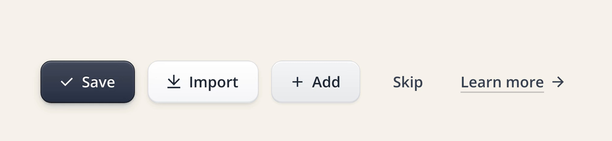

# 有点击手感的拟物按钮 / Tactile Skeuomorphic Button

实现配方附高清演示截图；参数是可调起点，仍需在目标项目与浏览器中验证。

## 效果参考



静态图用于核对构图、材质与可见状态；触发、连续运动和焦点管理需在实际项目中验证。

## 适用与边界

primary、secondary、tertiary、ghost、text 五种层级共享五层材质 token；按下时位移、渐变和阴影同步改变，尺寸随字号成比例缩放。

五层依次为面色渐变、边框、顶部内高光、底部内暗边、接触与抬升双投影。14px 字号下高 40px、圆角 10px、横向内边距 18px；用 u = 字号 / 14 缩放全部长度。按下位移 1px、反转渐变、收拢投影；transform / shadow / color 起点为 120 / 140 / 160ms。静止与按下的内阴影层数一致，避免插值跳变。

## 核对

检查五种变体在 hover、pressed、focus-visible、disabled 下的层级和圆角对齐；14px 与 16px 尺寸的材质同步缩放。

## 实现提示词

将下方配方应用于用户指定的组件或页面；其中 product、global、every 等范围以用户本次授权为界，不自动扩大到整站。已有设计系统和提交语义优先，新增设置面板、全局扫描和演示风格仅在任务需要时采用。

```text
Define a tactile, skeuomorphic Button component with five variants, from
strongest to weakest: primary, secondary, tertiary, ghost, text.
If the project already has a component library or design system, do not
add a new component: restyle its existing Button through its own variant
and token system, and keep its API, props and accessibility as they are.
Otherwise create one reusable Button with `variant` and `size` props.

Style: calm and precise. Neutral grays only, no brand hues. Lit from straight above.
No glossy Web 2.0 shine, no glow, no large blur.

Variants:
1. primary   - near-black slate face (#404859 -> #273042), white label
2. secondary - raised white key (#FFFFFF -> #F4F5F7), dark gray label
3. tertiary  - soft gray key (#F3F4F6 -> #E7E9EC), dark gray label
4. ghost     - no face at rest; faint gray fill on hover; a recessed well
               when pressed
5. text      - gray label with a thin underline and an arrow that nudges
               right on hover

Every filled variant is the same five material layers; only the values
change, so define them once as tokens and let each variant set its own:
1. Face: 180deg linear gradient, top 6-8% lighter than bottom.
2. Edge: 1px solid border one step darker than the bottom of the face
   (primary #12161F, secondary rgba(15,23,42,.14), tertiary rgba(15,23,42,.1)).
3. Top highlight: inset 0 1px 0 white (18% on slate, 85-100% on light
   faces). Put every inset layer in the button's own box-shadow, before the
   drop layers, never on a pseudo-element overlay: inset shadows on the
   element follow the inner radius (outer radius minus border), so the
   corners line up in every state.
4. Bottom shade: inset 0 -1px 0 black (22% on slate, 6% on light faces).
5. Drop shadow in two layers: a tight contact shadow 0 1px 2px plus a soft
   lift 0 4px 10px -3px (18% and 28% on slate, about a third of that on
   light faces).

States (hover, pressed/active, focus-visible, disabled):
- Hover: face one step lighter; the lift grows to 0 8px 16px -5px.
- Pressed: translateY(1px); flip the gradient (darker on top); the outer
  shadow collapses to 0 1px 1px; the top highlight becomes an inner shadow,
  inset 0 1px 2px black (40% on slate, 12-16% on light faces). Light faces
  keep a 1px white line below, 0 1px 0 rgba(255,255,255,.9), like a key
  pressed into paper.
- Give rest and pressed the same number of inset layers (pad with
  inset 0 0 0 transparent) so the shadow animates instead of jumping.
- Focus-visible and disabled follow the library's existing conventions.
- Timing: 120ms for transform, 140ms for shadows, 160ms for colors.

Sizes: all values above are for the 14px label size: height 40px,
padding 0 18px, radius 10px, label weight 600, optional 16px leading icon.
On the slate face add a label text-shadow 0 -1px 0 rgba(0,0,0,.28).
Scale the material with the type, never keep it at fixed pixels: express
every length (height, padding, radius, border, icon, the 1px press offset,
and every shadow offset, blur and spread) as a multiple of a size unit
u = label size / 14. Provide two sizes: md (14px label, u = 1px) and
lg (16px label, u = 16/14 px, so height 45.7px, radius 11.4px, lift shadow
0 4.6px 11.4px -3.4px).
```
