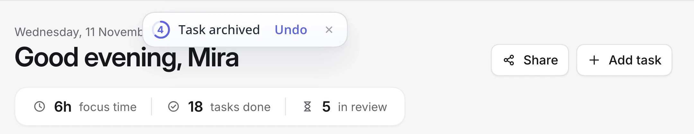
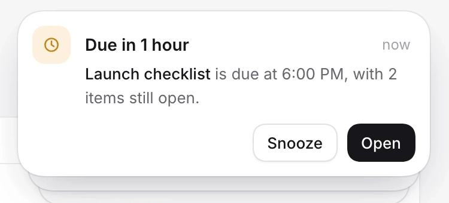

# 016 · Toast 和 Notification 怎么选？ / Toast vs Notification

先判断消息与当前操作的关系、是否需要处理以及错过后的影响，再选呈现方式。样式、位置与停留时间不能单独决定消息类型；在现有产品中诊断后，只实施用户选中的改动。

## 反馈选型

| 类型 | 适用情境 | 内容与生命周期 |
|---|---|---|
| Status Toast | 用户刚完成操作的简短结果，如复制成功 | 图标与短文案，无按钮；约 3–5s，长文适当延长 |
| Action Toast | 操作已经完成，允许一个后续动作，如真实 Undo | 短文案、一个动作与关闭；至少 5s，期限必须符合业务能力 |
| Progress Toast | 当前工作区内的上传、导出等任务 | 运行期间持续显示，同一位置变为结果与 Open；结果约 3s |
| Notification | 他人、系统或先前后台任务带来的消息 | 标题、正文与最多两个动作；跨页可达，并在收件箱／铃铛中保留历史 |
| 行内反馈 | 字段错误、必须修复的上传或支付失败 | 紧邻字段／条目，保留至修复并提供恢复入口；不能仅靠自动消失的 Toast |
| 执行前确认 | 无法撤销或影响较大的动作 | 按现有产品规则使用就地确认或 Dialog，执行后提示不能替代确认 |
| 原地状态或 Badge | 只需用户查看时知道的低优先级变化 | 更新真实状态与计数，无需额外打断 |

先盘点每条消息的触发者、文案、动作、位置、时长、历史入口、挂载位置与读屏方式，再输出 `Where / Now / Should be / Why / Change` 诊断表，标记已正确项和歧义项。仅诊断请求停在建议；已有明确选择与授权则直接实施，不重复要求 go-ahead。类型修正和视觉改造分别选择，保留项目已有栈、组件、字体、token 与文案风格。

## 视觉与动效起点

以下值按项目设计系统调整，不全局覆盖 [011 动画节奏](easing.md)。

- **Toast**：顶部居中，距顶栏约 12px；基础高度 40px、圆角 16px，白色至 `#f7f9fc` 轻渐变、1px 边框与双层柔影。图标 24px／圆角 8px，按钮 28px／圆角 10px，14/20 字号行高、间隔 8px；长文、窄屏、翻译与缩放时允许增高换行。
- **Toast 入退场**：入场 500ms、`cubic-bezier(.25,.1,.25,1)`，从 y=-10px、scale=.96、blur=8px 到终态；退场 220ms ease-in，y=-6px、blur=6px 并淡出。文字和控件整组移动；完成时只扫一次 900ms ease-out 高光，等待 Undo 时不扫光。
- **原地变结果**：旧内容 180ms 向上 5px 模糊淡出；新内容在 100–400ms 从下方 5px 清晰进入；宽度 380ms、`cubic-bezier(.32,.72,0,1)`。仅图标独立从 -40°、scale=.5 进入。Undo 确实成功后显示恢复状态约 1.5s。
- **Notification**：顶部右侧，距顶栏约 12px、宽 344px、圆角 24px、内距 12px；头像 32px，按钮高 32px／圆角 12px；标题 14/20 semibold、正文 13/20、最多两个动作，主动作最后。
- **通知堆叠**：新消息在前，后卡按前卡高度裁切、下露 12px，缩放 .95／.90，最多显示三张；其余仍可在历史中访问。新卡从上方 56px 入场，560ms、`cubic-bezier(.32,.72,0,1)`；旧卡保留内容后退，不做替换闪切。
- **通知展开与补位**：悬停或触摸／键盘显式展开为真实卡高、间距 8px，380ms 同曲线；展开时用轻影，堆叠时仅首卡深影。关闭／成功处理后向右 48px 淡出 260ms，其余 400ms 补位；展开列表末尾提供 Clear all。
- **减弱动态**：约 150ms 淡化，移除位移、缩放、模糊和扫光；深色主题减弱高光。连续运动、计时与交互需在真实产品中验证。

## 清晰效果参考

两张独立 WebP 直接从 2160×2880 视频解码，按原像素裁切，质量 98。不放大、不锐化、不涂抹、不跨帧拼接；保留 UI 自身内容，说明与参数放在文档中。复用同一组图片，不为三个检索入口重复存储。

### 带 Undo 的 Action Toast



2160×420。保留页面顶部上下文，显示短消息、倒计时圆环、Undo 与关闭的关系。静态图不能证明真实撤销、倒计时暂停或进度原地切换；示例中的浮层位置仍需按产品可读性避让。

### Notification 堆叠



750×340。用于核对圆角、内距、文字层级、按钮与堆叠边缘。展开列表、关闭、补位、跨页历史和未读数按配方实际验证，不重复添加近似帧。

## 集成边界

下面保留用户提供的完整提示词。应用时先按本节解释其中的简化规则，再采用详细参数。

- **真实撤销与确认**：仅对业务允许且确实可逆的动作建议 Undo。保持既有高影响、批量、权限和不可逆确认；关闭 Toast 不代表撤销。撤销失败持续显示在条目或可重访入口，不能先播报恢复成功。
- **期限与队列**：hover／焦点可暂停 UI 自动消失计时，不代表后端撤销期限暂停；剩余秒数对应真实期限，必要时提供持续可达入口。新 Toast 不能覆盖唯一的 Undo 或运行中任务入口；按稳定事件／任务 ID 排队、合并或原地更新，避免过时异步结果覆盖新任务，路由切换不丢运行状态。
- **消息状态与计数**：横幅已关闭、已读、已处理和待办是独立状态，Clear all 仅按既定语义清屏。安全／支付等需决策消息仍保留在历史，关闭不能标为问题解决。铃铛和标题使用真实未读／待办规则，保留原页面标题并兼容路由更新。
- **后台触达**：仅在产品已支持、权限允许且范围明确时使用系统通知；不因本配方自动请求权限。无权限或跨设备时按已有能力保留应用内历史与任务结果，不能依赖当前页 timer 保证后台送达，也不将系统通知说成所有平台唯一触达方式。
- **可读与可操作**：位置考虑顶栏、安全区、软键盘与现有模态层级，不遮挡关键内容或输入。40px 高、单行、344px 宽和三行正文是起点，关键内容不能被截断后无处查看；小按钮扩大到符合项目规范的触控命中区。关闭／展开不能只依赖 hover，键盘与触摸始终可达；卡片内动作不先触发展开或导航。
- **读屏与焦点**：普通状态使用独立的 polite status 文案区，操作控件保持正常语义，避免整块反复播报。通知按紧迫程度公告一次，不默认所有通知 assertive；进度只播关键变化，不逐秒读倒计时。不抢输入焦点；Escape 仅处理当前聚焦浮层，移除含焦点的卡片后给出稳定去向。
- **测量与平台**：沿用既有全局宿主或局部作用域，不无条件挂满整个应用。堆叠先批量测量真实卡高，再用 FLIP／transform 与必要容器高度过渡；避免逐帧布局读写。宽度变化用受控测量或不拉伸文字的变换，内容变化和 resize 后重新布局。触摸滑动与滚动冲突有回退，清屏不丢必须处理的事件。优先复用现有组件，新增 Sonner 或状态库须符合用户授权。

## 完整实现提示词

```text
Review how my product tells people that something happened, and decide for each message whether it should be a toast, a notification, or neither. Then, if I want it, restyle the toasts and notifications along the lines below. This is about judgment first: diagnose and recommend, and change only what I approve.

This is a change to my product, not a demo. Work inside my code, on my stack, with my components, tokens, corner scale, fonts and copy style. Do not add a dependency, a new state library or a new visual pattern without asking. Every value below is a default to start from.

0. Read the product first
- Find every place that shows a message about an event: toasts and snackbars, alerts and banners, notification lists, inbox or activity panels, badges and counts, inline success and error text, and browser or push notifications.
- For each one, note: what triggers it (the person's own action, another person, the system, a background job), what it says, any buttons, where it appears, how long it stays, and whether it can be found again later.
- Find the components behind them and where they are mounted (one per page, or one for the whole app). Note how they announce themselves to screen readers.
- Tell me in a few lines what you found before going on.

1. What each one is for
- Toast: answers something the person just did, in the place they are working. It is short, it does not interrupt, and it goes away by itself. It comes in three kinds:

a. Status: confirms a result, so the person does not have to go and check. An icon and a few words, no buttons. Example: "Link copied".

b. Action: the action has already been done, and the toast holds the one step that may follow, usually Undo. One line and one button, plus a close. It stays long enough to use the button, with the time left shown.

c. Progress: work that takes a moment. It shows that the work is under way, then turns into the result in the same place, with a button to see it. Example: "Uploading brand-guide.pdf" turns into "Uploaded to Files, Open".
- Notification: news the person did not cause just now, from other people or from the system: a mention, a reply, a payment, a deadline, a security alert, a finished report. It can carry more: a title, a few lines and up to two actions. It is shown on every page, stays until it is opened, handled or closed, and several can be shown at once. It is also kept somewhere the person can find it again (an inbox or a list behind a bell, with a count).
- Neither:
  - A form error or a problem with one field: show it next to the field.
  - A failure the person has to fix (an upload that failed, a payment that did not go through): keep it on the item, with a way to fix it, until it is fixed. A toast that disappears after a few seconds is not enough.
  - An action that cannot be undone: ask before doing it (a confirm next to the button, or a dialog for something with a large impact). A toast after the fact is too late.
  - Something only worth seeing when the person looks: a badge, a dot or a change of state in place, with no message at all.

2. Questions that settle a case
- Who caused it? The person, just now: toast. Someone else, the system, or the person a while ago in another place: notification.
- Does the person need to act? No: status toast. One quick step that may follow (Undo, View): action toast. A real decision or a reply: notification. Something that must be fixed: keep it on the item.
- Can the action be undone? Then do it at once and offer Undo in a toast instead of asking first. If it cannot be undone, confirm before, not after.
- How much is there to say? A few words: toast. A sentence or two, a name, an amount, a place: notification.
- Would it matter if the person missed it? No: toast. Yes: notification, kept until handled.
- Is the work still running when the person leaves? If it ends while they are still on the page, a toast is enough. If they have moved to another tab or app, a browser or system notification (with permission) is the only way to reach them; inside the product, it also goes into the notification list.
- Several at once? Toasts: one at a time; a new one replaces the old one, or waits. Notifications: they stack.

3. Report before changing anything
Give me a table first, and do not change code yet. One row per message:
- Where: the screen or component, and what triggers it.
- Now: how it is shown today, in a few words.
- Should be: status toast, action toast, progress toast, notification, or neither (and which).
- Why: one line, using the questions above.
- Change: what would change (kind, wording, buttons, how long it stays, where it is kept). Mark the ones that are already right. Mark the ones that could go either way and say what decides between them, as a question for me. Then list anything missing: an action that should offer Undo, a failure that only shows a toast, a background job that never says it is done, news with no place to find it again. Then ask me which rows to change and wait.

4. Optional: restyle the toast and the notifications
After the table, offer these as a separate choice, and wait for my answer:
A. Restyle the toast only.
B. Restyle the notifications only.
C. Both.
D. Neither; just fix the kinds and wording.
For each one I pick, show me a short before and after (values and motion), in my product's own colours and corners, and wait for my go-ahead before building.

4A. Toast
- Place: the top centre of the page, 12 under the top bar, over the content. One at a time.
- Shape: 40 tall, 16 corners (or the nearest step in my corner scale), a white surface with a soft top-to-bottom gradient (#ffffff to #f7f9fc), a 1px border rgba(214, 219, 227, 0.95), and a soft shadow (0 16px 36px rgba(17, 24, 39, 0.08), 0 3px 10px rgba(17, 24, 39, 0.05)). Inner shapes are concentric with it: the icon, 8 in, is 24 with 8 corners; a button or the close, 6 in, is 28 with 10 corners.
- Content: icon, then one line of 14/20 text, then the button and the close if there are any. The done icon is a check on a soft tile in my accent colour; work in progress is a ring; the time left to undo is a ring that empties, with the seconds in its centre. The button is accent-coloured text, with a tint only on hover. Keep the gaps tight: 8 between the icon and the text, the button and the close next to each other.
- Enter: in 500ms on cubic-bezier(0.25, 0.1, 0.25, 1), the whole toast comes down from 10px above, grows from 96% and clears from an 8px blur; it is fully opaque a little before the end. Text and controls move with it as one piece, not letter by letter.
- Leave: 220ms, ease-in: up 6px, blur 6px, fade out.
- Sheen: a light band crosses it once (900ms, ease-out) only when something is done: a status toast as it enters, a progress toast as it turns into its result, an Undo toast after Undo. An action toast that still waits for a choice enters without it.
- Change in place (progress to result, archived to restored): the old line (text, button and close together) blurs out and moves 5px up in 180ms; the new line blurs in from 5px below between 100 and 400ms; the toast takes its new width in 380ms on cubic-bezier(0.32, 0.72, 0, 1). Only the icon has a move of its own: the old one shrinks and blurs away while the new one turns in from -40 degrees and half size.
- After Undo: the change is reverted, and the toast says so ("Task restored") for about 1.5 seconds before it leaves.
- Timing: a status toast stays 3 to 5 seconds, longer for longer text; an action toast at least 5 seconds; a progress toast stays while the work runs, then 3 seconds. The timer pauses while the pointer is over the toast or focus is inside it.

4B. Notifications
- Place: the top right, 12 under the top bar, the same on every page, above the content. 344 wide.
- Card: 24 corners with 12 of padding, so the picture (32, a person's photo or the product's logo) and the buttons (32 tall, 12 corners) are concentric with it. A title (14/20, semibold) with the time on the right, up to three lines of 13/20 text, then up to two buttons on the bottom right, the main one last.
- A stack: the newest is in front. The older ones are cut to the front one's height and peek out 12 below it, at 95% and 90%, showing only their edge; at most three show.
- A new one arrives: it slides down onto the stack from 56px above in 560ms on cubic-bezier(0.32, 0.72, 0, 1), clearing from a light blur, while the others are pushed down and back a step. The one it covers keeps its content until the new one is on its way over it, so it reads as stacking, not replacing.
- Hover: the stack spreads into a list at the cards' own heights, 8 apart, in 380ms on the same curve. In the list each card keeps to a hairline and a light shadow, so no shadow falls on the card below; stacked, only the front card has the deep shadow.
- Close one, as on macOS: a small close button (24, 10 corners) appears over a card's top-left corner while the pointer is on that card. Handling a card with one of its buttons also removes it. A removed card slides 48px to the right and fades in 260ms, and the ones below close the gap in 400ms. "Clear all" sits under the last card while the list is spread out.
- Counts: the bell shows how many are waiting, and so does the page title, so a tab in the background shows it too. Notifications that need a decision (security, payments) stay in the list behind the bell even when they are cleared from the screen.

4C. For both
- Reduced motion: keep the change of state and a short fade (about 150ms); drop the movement, scaling and blur.
- Screen readers: toasts are announced politely (role="status"); a notification that needs attention is announced once as it arrives. Neither takes focus away from what the person is doing. Their buttons can be reached by keyboard, and Escape closes the one in focus.
- Touch: the same places, with swipe to dismiss; there is no hover, so the stack spreads on tap.
- Dark mode: the same rules on my dark surfaces; the sheen is fainter.

5. Build what I pick
- List the files you will touch and wait for my go-ahead.
- Change one thing at a time and keep what each action does. Then check:
  - Short and long text, a missing picture, many notifications at once, several toasts in a row.
  - Undo used, ignored and closed; a progress that fails; leaving the page while something is still running.
  - Phone and desktop layouts, light and dark, reduced motion, keyboard and screen reader.
  - Existing tests still pass.
- Web: CSS transitions or the Web Animations API for the toast; for the stack, measure each card's height and animate transform and height together. Sonner (React) has a similar stack and can be adapted, but ask before adding it. iOS, Android and Flutter: use the platform's own animation tools with the same values; for messages that reach people outside the app, use the system's notifications.
```

## 项目核对

- 每条消息的类型、文案、动作、时长、历史入口与挂载范围有明确记录；仅实施选中项。
- 测试长短文、缺图、并发通知、连续 Toast、真实 Undo 的成功／失败／过期与主动关闭。
- 进度成功或失败原地更新；离页、卸载、跨页返回和异步结果竞态不丢任务入口。
- 通知关闭、清屏、已读、处理及计数分别正确；必须处理的问题可重访，系统通知按真实权限与平台能力验证。
- 手机／桌面、浅深色、减弱动态、键盘／触摸与读屏分别核对；静态图不代替行为验证。

关联配方：[009 浮层与确认选型](overlay-decision.md)、[011 动画节奏](easing.md)、[015 连续转场](continuous-transitions.md)。
