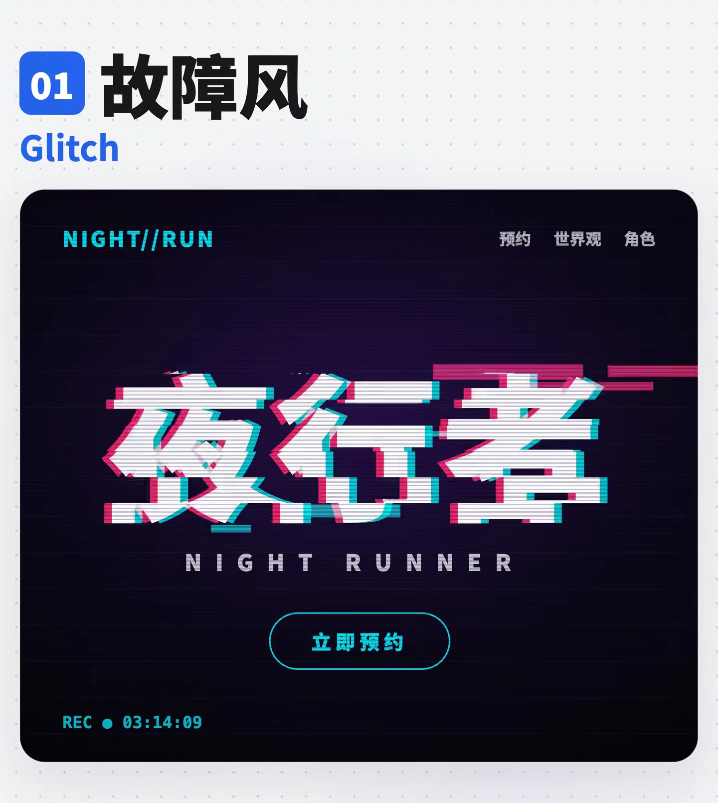
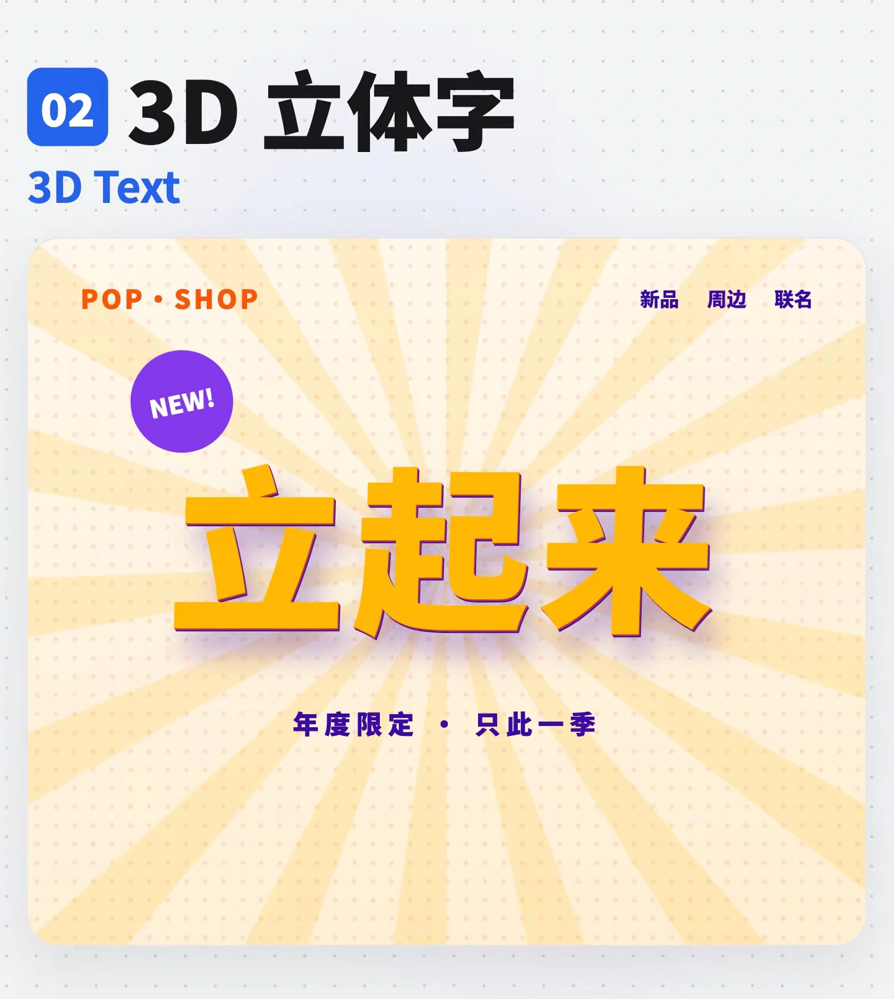
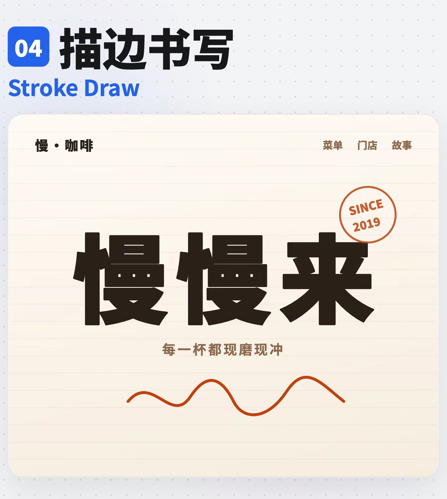
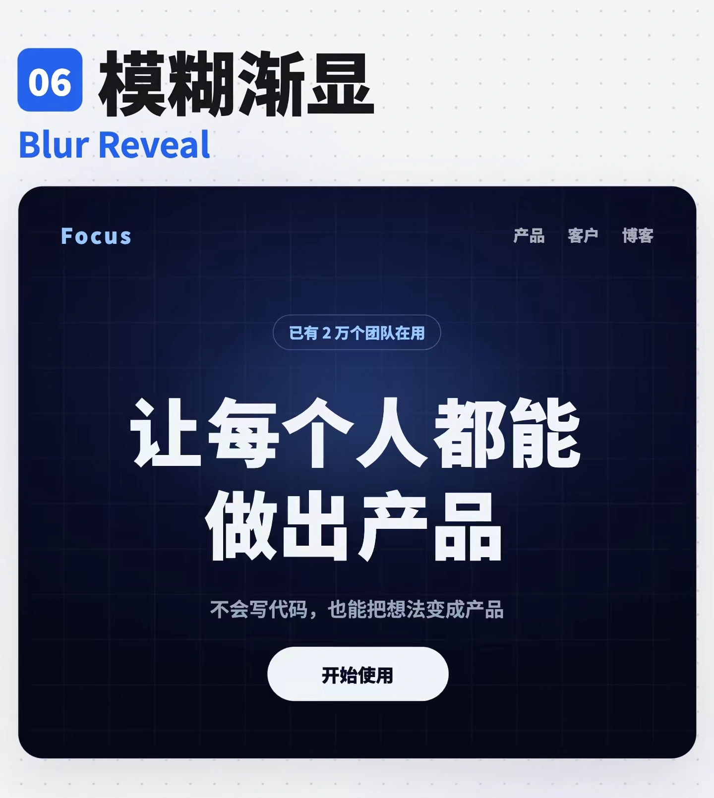
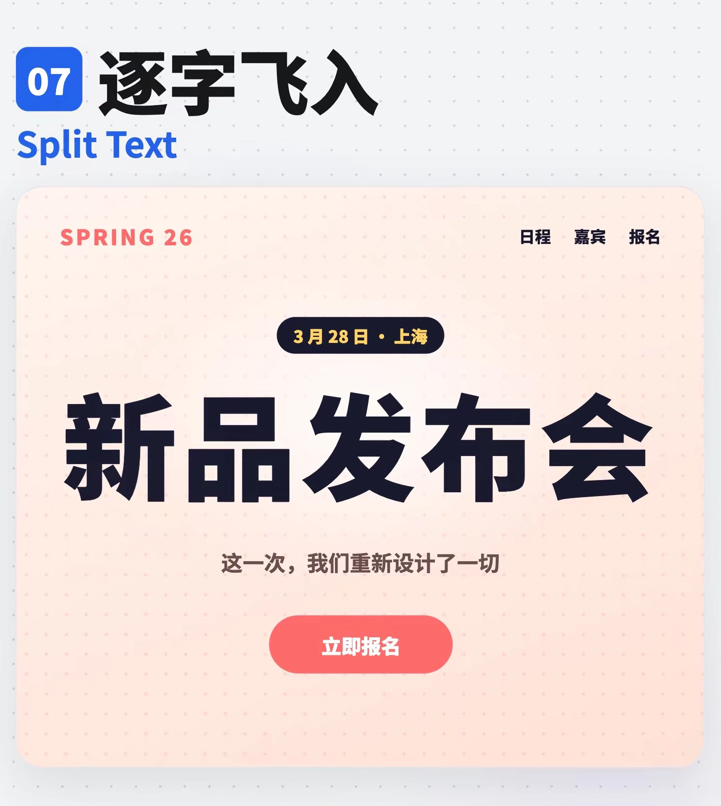
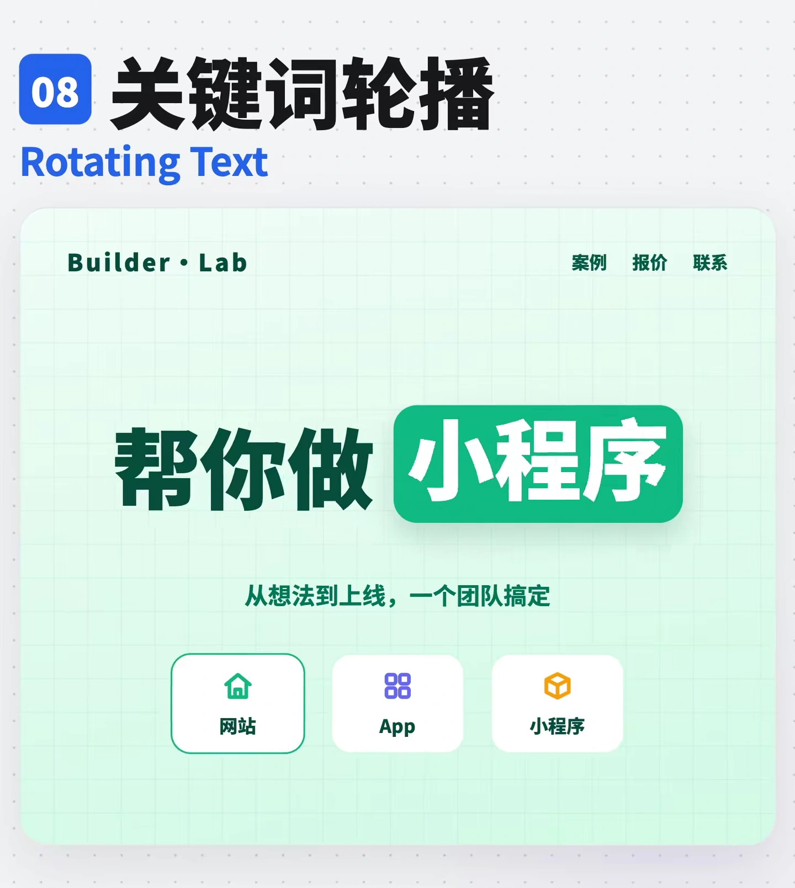
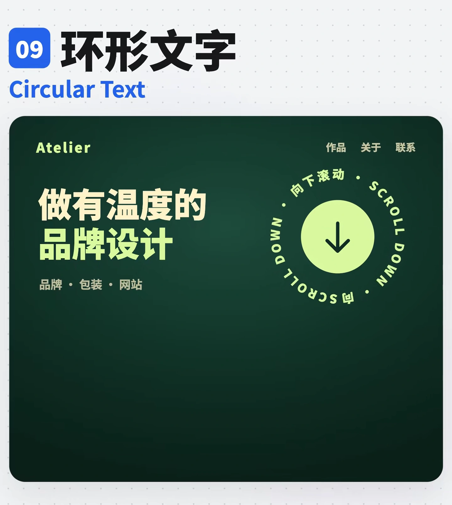
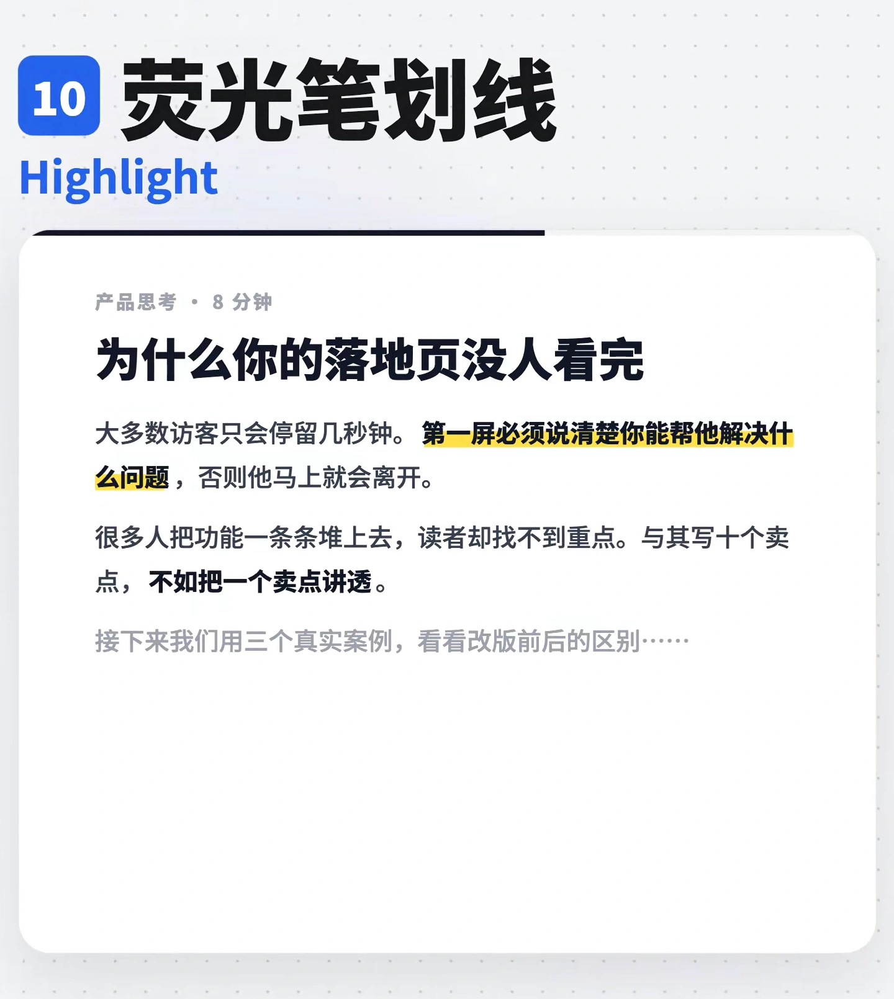
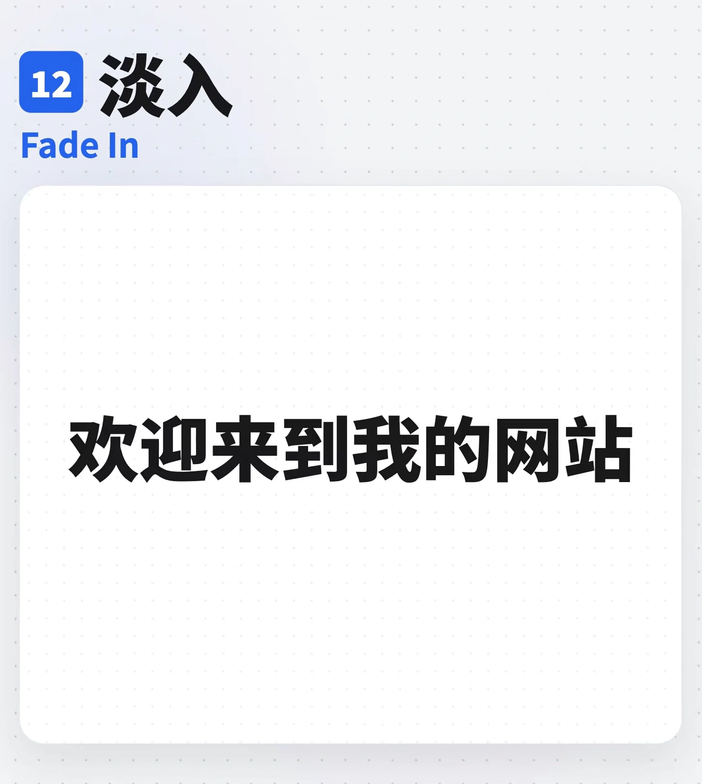

# 文字特效

按用户的目标、既有设计系统和实际触发方式选择。示例中的品牌与业务文案只用于说明；参数作为实现起点，连续行为需在项目中验证。

## 目录

- [故障风文字](#glitch)
- [3D 立体字](#three-dimensional)
- [文字镂空](#text-mask)
- [描边书写文字](#stroke-draw)
- [渐变流光字](#gradient-text)
- [文字模糊渐显](#blur-reveal)
- [逐字飞入](#split-text)
- [关键词轮播](#rotating-text)
- [环形文字](#circular-text)
- [荧光笔划线](#highlight)
- [波浪字](#wavy-text)
- [文字淡入](#fade-in)

## 故障风文字 / Glitch

- 标识：`text-effects/glitch`；类型：组件／效果。
- 适用场景：赛博、游戏、创意宣传的短标题。
- 画面要点：标题短暂出现色道错位和水平切片，随后恢复可读。
- 实现提示词：为短标题添加 Glitch：偶发的色道偏移与小幅水平切片后立即恢复，正文保持稳定，减弱动态时显示完整标题。
- 核对要点：不能持续高频闪烁或影响阅读；不同文字长度下都能完整显示。

<!-- ui-atlas:details text-effects/glitch -->
- 原尺寸图片：[01 · 1440×1610](../assets/details/text-effects/glitch-hd-01.webp)。
- 清晰度边界：从 2160 像素高的原片按原像素裁切，WebP 质量 95，不放大、不锐化、不涂抹；静态帧不能证明完整运动。

<!-- /ui-atlas:details -->

## 3D 立体字 / 3D Text

- 标识：`text-effects/three-dimensional`；类型：组件／效果。
- 适用场景：活动、商品与趣味品牌的视觉标题。
- 画面要点：厚度层、侧面阴影与轻微倾斜让标题具有立体感。
- 实现提示词：为短标题实现 3D Text，用一致方向的厚度层和阴影建立纵深，正面文字保留清晰边缘；不要挤压标题行高。
- 核对要点：检查窄屏、换行、长字串和背景对比；装饰厚度不裁切正文。

<!-- ui-atlas:details text-effects/three-dimensional -->
- 原尺寸图片：[01 · 1440×1610](../assets/details/text-effects/three-dimensional-hd-01.webp)。
- 清晰度边界：从 2160 像素高的原片按原像素裁切，WebP 质量 95，不放大、不锐化、不涂抹；静态帧不能证明完整运动。

<!-- /ui-atlas:details -->

## 文字镂空 / Text Mask

- 标识：`text-effects/text-mask`；类型：组件／效果。
- 适用场景：字形足够粗、图片可识别的品牌标题。
- 画面要点：图片或渐变只在粗体字形范围内出现，让文字承担图像遮罩。
- 实现提示词：将指定图片或渐变裁切到粗体标题字形中，实现 Text Mask；选用足够粗的字体，并提供可读的纯色后备。
- 核对要点：细笔画会损失画面；检查背景加载失败、选中文字及减弱动态时的可读性。

<!-- ui-atlas:details text-effects/text-mask -->
- 原尺寸图片：[01 · 1440×1610](../assets/details/text-effects/text-mask-hd-01.webp)。
- 清晰度边界：从 2160 像素高的原片按原像素裁切，WebP 质量 95，不放大、不锐化、不涂抹；静态帧不能证明完整运动。

<!-- /ui-atlas:details -->

## 描边书写文字 / Stroke Draw

- 标识：`text-effects/stroke-draw`；类型：组件／效果。
- 适用场景：手写、咖啡、文创与慢节奏的标题演示。
- 画面要点：字形轮廓按路径逐步绘出，之后可填充文字正面。
- 实现提示词：用匹配字形的 SVG 路径实现 Stroke Draw，先绘制轮廓再填充；时序以完整字形为单位，最终留下可读文字。
- 核对要点：真实路径需匹配字体；不能把整段透明度变化称为书写，辅助技术只读取一次文本。

<!-- ui-atlas:details text-effects/stroke-draw -->
- 原尺寸图片：[01 · 1440×1610](../assets/details/text-effects/stroke-draw-hd-01.webp) · [02 · 1440×1610](../assets/details/text-effects/stroke-draw-hd-02.webp)。
- 多图用途：保留轮廓绘制与填充完成两个必要状态。
- 清晰度边界：从 2160 像素高的原片按原像素裁切，WebP 质量 95，不放大、不锐化、不涂抹；静态帧不能证明完整运动。

<!-- /ui-atlas:details -->

## 渐变流光字 / Gradient Text

- 标识：`text-effects/gradient-text`；类型：组件／效果。
- 适用场景：产品首屏与需要局部强调的短标题。
- 画面要点：渐变颜色沿标题缓慢流动，字形和位置保持稳定。
- 实现提示词：将渐变裁切进标题，用缓慢的背景位置变化产生 Gradient Text，保持字形、字重和行高稳定，降低动态时静止。
- 核对要点：每个渐变位置的文字对比都可读；不向正文或整页扩散。

<!-- ui-atlas:details text-effects/gradient-text -->
- 原尺寸图片：[01 · 1440×1610](../assets/details/text-effects/gradient-text-hd-01.webp)。
- 清晰度边界：从 2160 像素高的原片按原像素裁切，WebP 质量 95，不放大、不锐化、不涂抹；静态帧不能证明完整运动。

<!-- /ui-atlas:details -->

## 文字模糊渐显 / Blur Reveal

- 标识：`text-effects/blur-reveal`；类型：组件／效果。
- 适用场景：一次性首屏或区块标题入场。
- 画面要点：标题从低透明度与轻度模糊过渡到清晰静止，最终完整显示。
- 实现提示词：为标题实现一次 Blur Reveal：从低透明度和轻微模糊过渡到清晰文字，结束后移除滤镜；正文保持正常阅读。
- 核对要点：模糊属于有意的入场状态；不能把图片低清误当效果，减弱动态直接显示最终清晰文字。
- 关联条目：`loading-errors/blur-up`。

<!-- ui-atlas:details text-effects/blur-reveal -->
- 原尺寸图片：[01 · 1440×1610](../assets/details/text-effects/blur-reveal-hd-01.webp) · [02 · 1440×1610](../assets/details/text-effects/blur-reveal-hd-02.webp)。
- 多图用途：保留模糊入场过程与最终清晰态；前者为刻意效果，并非低清素材。
- 清晰度边界：从 2160 像素高的原片按原像素裁切，WebP 质量 95，不放大、不锐化、不涂抹；静态帧不能证明完整运动。

<!-- /ui-atlas:details -->

## 逐字飞入 / Split Text

- 标识：`text-effects/split-text`；类型：组件／效果。
- 适用场景：新品发布或强调语句节奏的短标题。
- 画面要点：句子拆成字或词，按短暂错峰从下方进入，组成完整标题。
- 实现提示词：将标题按合适的字／词分组，按短暂错峰从下方淡入归位，实现 Split Text；保留原始阅读顺序，完成后稳定。
- 核对要点：中文、标点、空格和换行保持正确；屏幕阅读器不逐个读装饰副本，减弱动态直接呈现全文。
- 关联条目：`motion/stagger`。

<!-- ui-atlas:details text-effects/split-text -->
- 原尺寸图片：[01 · 1440×1610](../assets/details/text-effects/split-text-hd-01.webp) · [02 · 1440×1610](../assets/details/text-effects/split-text-hd-02.webp)。
- 多图用途：保留逐字飞入中与归位后的两个必要状态。
- 清晰度边界：从 2160 像素高的原片按原像素裁切，WebP 质量 95，不放大、不锐化、不涂抹；静态帧不能证明完整运动。

<!-- /ui-atlas:details -->

## 关键词轮播 / Rotating Text

- 标识：`text-effects/rotating-text`；类型：组件／效果。
- 适用场景：固定句式中的少量服务或能力关键词。
- 画面要点：固定句式中只轮换一个关键词，周围文字保持不动。
- 实现提示词：固定标题句式，仅在预留的关键词容器内轮换词语，使用清楚的淡入或竖向切换；按最长词预留空间以免布局跳动。
- 核对要点：轮换间隔允许读完；关键词含义不丢失，不依赖持续朗读的 live region，减弱动态展示完整静态表述。

<!-- ui-atlas:details text-effects/rotating-text -->
- 原尺寸图片：[01 · 1440×1610](../assets/details/text-effects/rotating-text-hd-01.webp)。
- 清晰度边界：从 2160 像素高的原片按原像素裁切，WebP 质量 95，不放大、不锐化、不涂抹；静态帧不能证明完整运动。

<!-- /ui-atlas:details -->

## 环形文字 / Circular Text

- 标识：`text-effects/circular-text`；类型：组件／效果。
- 适用场景：品牌装饰、徽章与辅助滚动提示。
- 画面要点：文字沿圆周排列，可围绕中心图标缓慢旋转。
- 实现提示词：将短文本排布在圆形 SVG textPath 上，中心图标保持独立；需要运动时仅让环形文字缓慢匀速旋转。
- 核对要点：核对首尾间隔、字距和圆周方向；中心图标可单独操作，必要说明不能只放在旋转文字里。

<!-- ui-atlas:details text-effects/circular-text -->
- 原尺寸图片：[01 · 1440×1610](../assets/details/text-effects/circular-text-hd-01.webp)。
- 清晰度边界：从 2160 像素高的原片按原像素裁切，WebP 质量 95，不放大、不锐化、不涂抹；静态帧不能证明完整运动。

<!-- /ui-atlas:details -->

## 荧光笔划线 / Highlight

- 标识：`text-effects/highlight`；类型：组件／效果。
- 适用场景：文章、说明与重点语句。
- 画面要点：柔和色带位于重点字词后方，模拟划过的荧光笔标记。
- 实现提示词：在重点词后增加低透明度 Highlight 色带，横向展开后停留，字形在前景；一段只强调少数关键词。
- 核对要点：多行断行时高亮逐行正确，不遮挡字脚；高亮色在当前主题中仍保持可读。

<!-- ui-atlas:details text-effects/highlight -->
- 原尺寸图片：[01 · 1440×1610](../assets/details/text-effects/highlight-hd-01.webp)。
- 清晰度边界：从 2160 像素高的原片按原像素裁切，WebP 质量 95，不放大、不锐化、不涂抹；静态帧不能证明完整运动。

<!-- /ui-atlas:details -->

## 波浪字 / Wavy Text

- 标识：`text-effects/wavy-text`；类型：组件／效果。
- 适用场景：儿童、游戏与轻松活动的短标题。
- 画面要点：各字以小幅上下位移形成连续波浪，适合短标题。
- 实现提示词：为短标题的字形施加按索引错开的轻微纵向波动，形成 Wavy Text；保留稳定的总体占位，正文不参与运动。
- 核对要点：不裁切上下边缘；控制幅度与节奏，减弱动态静止，文字顺序和可访问名称不变。

<!-- ui-atlas:details text-effects/wavy-text -->
- 原尺寸图片：[01 · 1440×1610](../assets/details/text-effects/wavy-text-hd-01.webp)。
- 清晰度边界：从 2160 像素高的原片按原像素裁切，WebP 质量 95，不放大、不锐化、不涂抹；静态帧不能证明完整运动。

<!-- /ui-atlas:details -->

## 文字淡入 / Fade In

- 标识：`text-effects/fade-in`；类型：组件／效果。
- 适用场景：需要克制入场的通用文字区块。
- 画面要点：文字从透明到完整显示，不改变位置、字形和清晰度。
- 实现提示词：让标题在指定入场触发后仅从透明过渡到可读状态，最终保持 opacity 1；不额外增加位移、模糊或逐字延迟。
- 核对要点：检查隐藏前后仍保留合理布局；不要与 Blur Reveal、Split Text 或滚动触发机制混淆。
- 关联条目：`motion/scroll-reveal`。

<!-- ui-atlas:details text-effects/fade-in -->
- 原尺寸图片：[01 · 1440×1610](../assets/details/text-effects/fade-in-hd-01.webp)。
- 清晰度边界：从 2160 像素高的原片按原像素裁切，WebP 质量 95，不放大、不锐化、不涂抹；静态帧不能证明完整运动。

<!-- /ui-atlas:details -->
