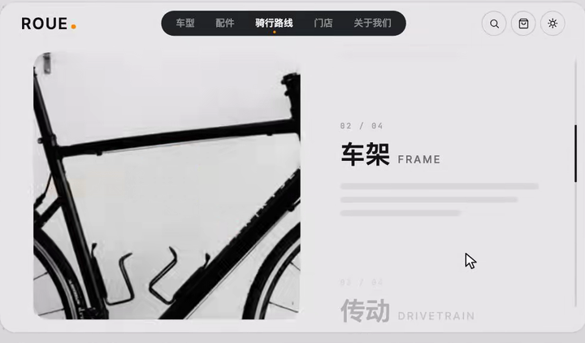
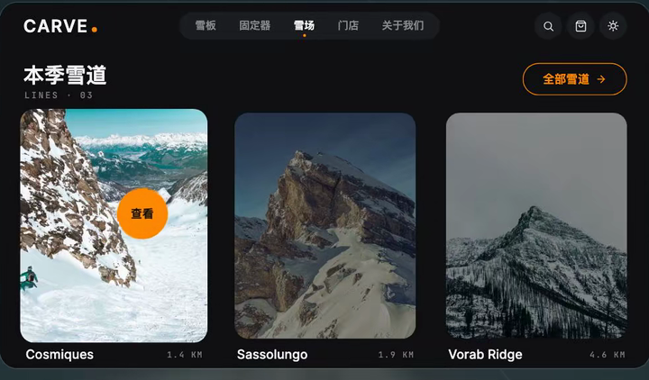
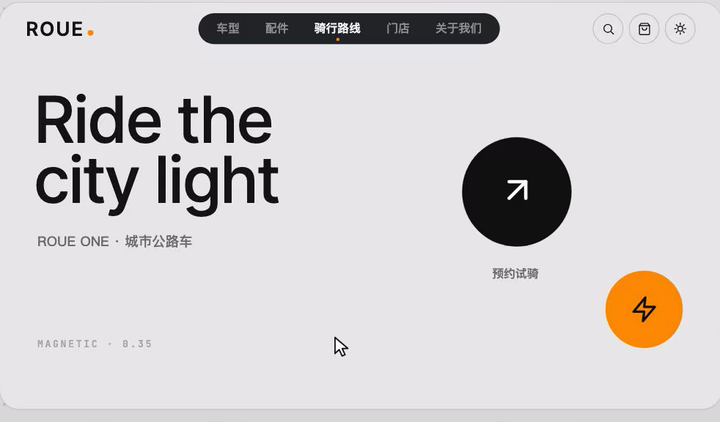
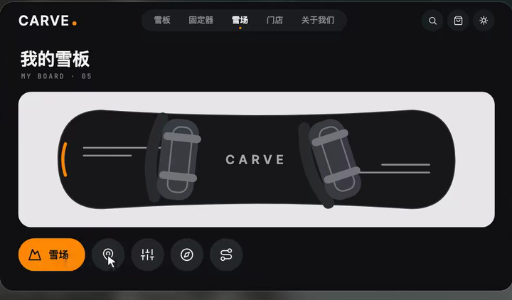
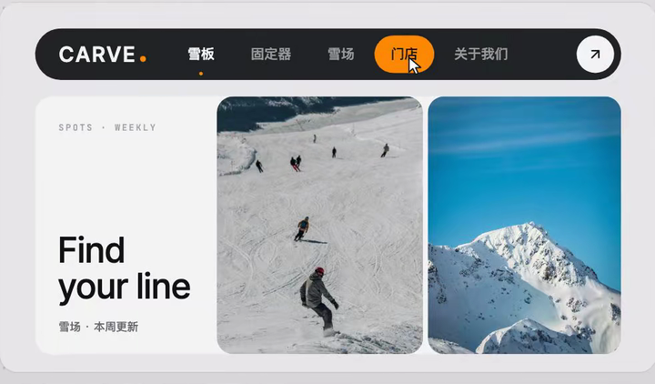
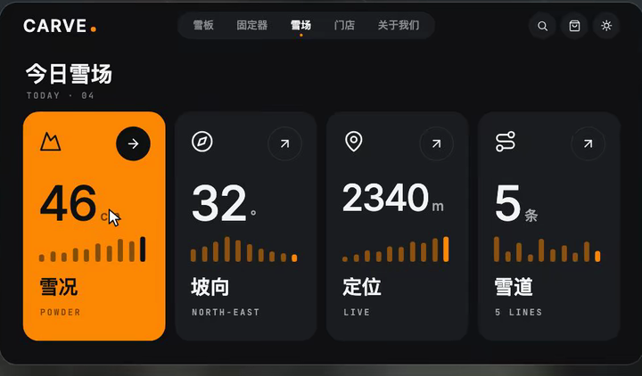
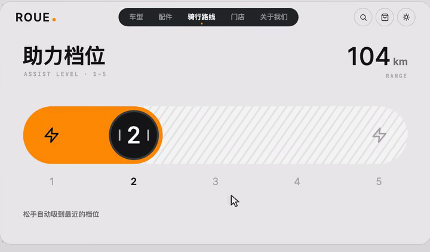
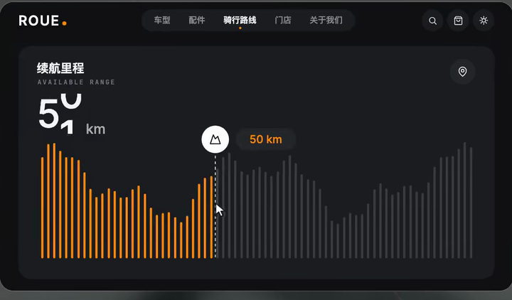
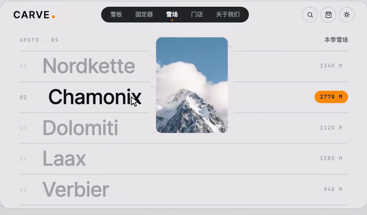
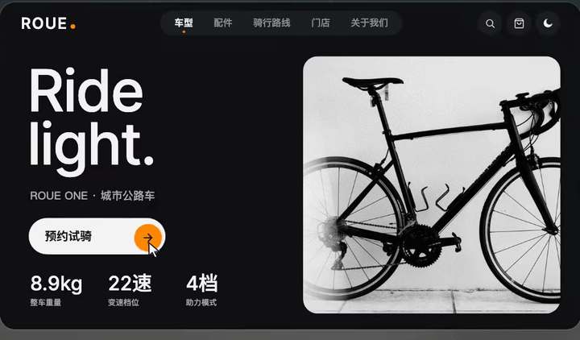

# Web 微交互

先确定悬停、聚焦、点击或滚动触发，再实现视觉变化。指针装饰不替代可访问名称；触摸端保留能完成同一任务的入口。

参考图用于核对构图与可见状态；连续动作在实际项目中验证。像素值、技术栈与缓动由当前项目决定。

## 目录

- [钉住主图的产品叙事](#sticky-product-story)
- [情境光标](#contextual-cursor)
- [磁吸主操作按钮](#magnetic-cta)
- [图标按钮展开标签](#expanding-icon-label)
- [导航底色跟随](#sliding-nav-highlight)
- [角落扩散填色](#corner-fill-hover)
- [分档吸附拖动条](#snapping-level-slider)
- [柱状图跟手读数](#scrubbing-bar-chart)
- [列表悬停预览图](#hover-image-preview)
- [圆形扩散换肤](#circular-theme-reveal)

## 钉住主图的产品叙事 / Sticky Product Story

- 标识：`web-interactions/sticky-product-story`；类型：组件／效果。
- 效果要点：主图区域在滚动中固定，旁侧说明分段切换，并突出当前讲解的产品部位。
- 指令例句：产品介绍区钉住主图，滚动时切换说明和相应的局部强调。
- 实现关注：共享分段进度驱动说明与高亮；固定仅限该章节，章节结束恢复正常文档流。
- 验证重点：向前和反向滚动时图文对应；窄屏采用顺序阅读且没有过长空白。
- 相关条目：[motion/scroll-storytelling](motion.md#scroll-storytelling)。
- 媒体取舍：保留静态效果图与实现说明；连续路径、触发顺序、节奏和短暂状态需在项目中实际验证。

<!-- ui-atlas:details web-interactions/sticky-product-story -->
- 原尺寸图片：[01 · 720×422](https://raw.githubusercontent.com/dqzboy/ui-atlas/4d61e1224c50685c02acae3ae67ebe9c217fa3b9/assets/details/web-interactions/sticky-product-story.png)。
- 清晰度边界：保留总览合成前的独立 PNG 帧；这些帧已在旧导出时缩到 300–720 像素宽，缺少更高分辨率原片。

<!-- /ui-atlas:details -->

## 情境光标 / Contextual Cursor

- 标识：`web-interactions/contextual-cursor`；类型：组件／效果。
- 效果要点：指针进入可交互区域后从小点变为带动作文字的圆形提示，离开恢复。
- 指令例句：在作品卡片内将光标变为带动作说明的圆形，离开恢复普通指针。
- 实现关注：自定义光标不接收指针事件；交互元素保留原生语义、名称和焦点反馈，触摸端用常规可见入口。
- 验证重点：跨多个目标、滚出区域和键盘操作不遗留圆形光标，不遮挡要读的文字。
- 媒体取舍：保留静态效果图与实现说明；连续路径、触发顺序、节奏和短暂状态需在项目中实际验证。

<!-- ui-atlas:details web-interactions/contextual-cursor -->
- 原尺寸图片：[01 · 720×422](https://raw.githubusercontent.com/dqzboy/ui-atlas/4d61e1224c50685c02acae3ae67ebe9c217fa3b9/assets/details/web-interactions/contextual-cursor.png)。
- 清晰度边界：保留总览合成前的独立 PNG 帧；这些帧已在旧导出时缩到 300–720 像素宽，缺少更高分辨率原片。

<!-- /ui-atlas:details -->

## 磁吸主操作按钮 / Magnetic CTA

- 标识：`web-interactions/magnetic-cta`；类型：组件／效果。
- 效果要点：指针靠近时按钮向指针小幅偏移，离开后弹性复位，点击热区保持可靠。
- 指令例句：主操作按钮加入小幅磁吸和离开回弹，保留稳定的点击区域。
- 实现关注：位移放在内部视觉层，外层负责命中；幅度受按钮尺寸限制，不把其他按钮也默认磁吸。
- 验证重点：边缘点击、快速掠过、离开和键盘激活均正常。
- 相关条目：[motion/magnetic](motion.md#magnetic)。
- 媒体取舍：保留静态效果图与实现说明；连续路径、触发顺序、节奏和短暂状态需在项目中实际验证。

<!-- ui-atlas:details web-interactions/magnetic-cta -->
- 原尺寸图片：[01 · 720×422](https://raw.githubusercontent.com/dqzboy/ui-atlas/4d61e1224c50685c02acae3ae67ebe9c217fa3b9/assets/details/web-interactions/magnetic-cta.png)。
- 清晰度边界：保留总览合成前的独立 PNG 帧；这些帧已在旧导出时缩到 300–720 像素宽，缺少更高分辨率原片。

<!-- /ui-atlas:details -->

## 图标按钮展开标签 / Expanding Icon Label

- 标识：`web-interactions/expanding-icon-label`；类型：组件／效果。
- 效果要点：紧凑图标按钮在悬停时展开为含文字的胶囊，离开后收回。
- 指令例句：工具栏图标悬停或聚焦时展开文字，图标始终可辨认。
- 实现关注：预留或平滑分配展开宽度，避免挤压相邻命中区域；可访问名称始终存在。
- 验证重点：最左与最右按钮、键盘聚焦和触摸端都能理解并执行操作。
- 媒体取舍：保留静态效果图与实现说明；连续路径、触发顺序、节奏和短暂状态需在项目中实际验证。

<!-- ui-atlas:details web-interactions/expanding-icon-label -->
- 原尺寸图片：[01 · 720×422](https://raw.githubusercontent.com/dqzboy/ui-atlas/4d61e1224c50685c02acae3ae67ebe9c217fa3b9/assets/details/web-interactions/expanding-icon-label.png)。
- 清晰度边界：保留总览合成前的独立 PNG 帧；这些帧已在旧导出时缩到 300–720 像素宽，缺少更高分辨率原片。

<!-- /ui-atlas:details -->

## 导航底色跟随 / Sliding Navigation Highlight

- 标识：`web-interactions/sliding-nav-highlight`；类型：组件／效果。
- 效果要点：导航圆角底色平滑移动到目标项，同时适配各项文字的宽度。
- 指令例句：导航高亮底色随目标项移动和变宽，离开预览后恢复当前页面选中项。
- 实现关注：将实际选中与指针预览分开；底色不拦截点击，字体加载或窗口变化后重新测量目标。
- 验证重点：不同宽度标签、键盘切换、页面刷新和返回后，底色与当前路由一致。
- 媒体取舍：保留静态效果图与实现说明；连续路径、触发顺序、节奏和短暂状态需在项目中实际验证。

<!-- ui-atlas:details web-interactions/sliding-nav-highlight -->
- 原尺寸图片：[01 · 720×422](https://raw.githubusercontent.com/dqzboy/ui-atlas/4d61e1224c50685c02acae3ae67ebe9c217fa3b9/assets/details/web-interactions/sliding-nav-highlight.png)。
- 清晰度边界：保留总览合成前的独立 PNG 帧；这些帧已在旧导出时缩到 300–720 像素宽，缺少更高分辨率原片。

<!-- /ui-atlas:details -->

## 角落扩散填色 / Corner Fill Hover

- 标识：`web-interactions/corner-fill-hover`；类型：组件／效果。
- 效果要点：功能卡片从一角扩散主题色，文字和图标同步换色，箭头转向。
- 指令例句：可点击统计卡悬停时从右上角扩散填色，并同步调整文字和箭头。
- 实现关注：扩散层裁剪在卡内，内容层保持固定；文字切色与背景覆盖节奏配合，触摸和聚焦提供等价反馈。
- 验证重点：快速进出和跨卡片移动无残留，过渡中数字和图标也清晰。
- 媒体取舍：保留静态效果图与实现说明；连续路径、触发顺序、节奏和短暂状态需在项目中实际验证。

<!-- ui-atlas:details web-interactions/corner-fill-hover -->
- 原尺寸图片：[01 · 720×422](https://raw.githubusercontent.com/dqzboy/ui-atlas/4d61e1224c50685c02acae3ae67ebe9c217fa3b9/assets/details/web-interactions/corner-fill-hover.png)。
- 清晰度边界：保留总览合成前的独立 PNG 帧；这些帧已在旧导出时缩到 300–720 像素宽，缺少更高分辨率原片。

<!-- /ui-atlas:details -->

## 分档吸附拖动条 / Snapping Level Slider

- 标识：`web-interactions/snapping-level-slider`；类型：组件／效果。
- 效果要点：拖动条跨档时更新档位读数和填色，释放时吸附最近刻度。
- 指令例句：档位滑杆边拖边显示当前档位，松手吸附最近有效档。
- 实现关注：明确离散值集合与标签，指针位置映射为有效档位；键盘按档移动，视觉插值不产生非法业务值。
- 验证重点：首尾档、跨多档快速拖动、点击轨道和方向键操作均到达准确值。
- 相关条目：[forms/slider](forms.md#slider)。
- 媒体取舍：保留静态效果图与实现说明；连续路径、触发顺序、节奏和短暂状态需在项目中实际验证。

<!-- ui-atlas:details web-interactions/snapping-level-slider -->
- 原尺寸图片：[01 · 720×422](https://raw.githubusercontent.com/dqzboy/ui-atlas/4d61e1224c50685c02acae3ae67ebe9c217fa3b9/assets/details/web-interactions/snapping-level-slider.png)。
- 清晰度边界：保留总览合成前的独立 PNG 帧；这些帧已在旧导出时缩到 300–720 像素宽，缺少更高分辨率原片。

<!-- /ui-atlas:details -->

## 柱状图跟手读数 / Scrubbing Bar Chart

- 标识：`web-interactions/scrubbing-bar-chart`；类型：组件／效果。
- 效果要点：指针横扫柱图时，当前读数、标记和左右明暗区域跟随更新。
- 指令例句：柱状图支持横向跟手读取数据，标记、数值和高亮保持同步。
- 实现关注：以图表坐标找数据索引，提示用真实数据和单位；聚焦或触摸可选择数据点，离开后明确恢复策略。
- 验证重点：边界柱、零值、密集数据和缩放后，读数不偏一列，纵轴尺度不漂移。
- 媒体取舍：保留静态效果图与实现说明；连续路径、触发顺序、节奏和短暂状态需在项目中实际验证。

<!-- ui-atlas:details web-interactions/scrubbing-bar-chart -->
- 原尺寸图片：[01 · 720×422](https://raw.githubusercontent.com/dqzboy/ui-atlas/4d61e1224c50685c02acae3ae67ebe9c217fa3b9/assets/details/web-interactions/scrubbing-bar-chart.png)。
- 清晰度边界：保留总览合成前的独立 PNG 帧；这些帧已在旧导出时缩到 300–720 像素宽，缺少更高分辨率原片。

<!-- /ui-atlas:details -->

## 列表悬停预览图 / Hover Image Preview

- 标识：`web-interactions/hover-image-preview`；类型：组件／效果。
- 效果要点：文字列表保持整齐，悬停不同条目时在附近显示相应图片，非当前条目弱化。
- 指令例句：案例列表悬停或聚焦时预览对应图片，列表本身不跳动。
- 实现关注：图片浮层不参与列表排版且不挡点击；限制在可视区域内，触摸端用明确的预览入口。
- 验证重点：跨行快速移动、图片未加载、视口边缘和键盘聚焦都显示正确对应项。
- 媒体取舍：保留静态效果图与实现说明；连续路径、触发顺序、节奏和短暂状态需在项目中实际验证。

<!-- ui-atlas:details web-interactions/hover-image-preview -->
- 原尺寸图片：[01 · 720×422](https://raw.githubusercontent.com/dqzboy/ui-atlas/4d61e1224c50685c02acae3ae67ebe9c217fa3b9/assets/details/web-interactions/hover-image-preview.png)。
- 清晰度边界：保留总览合成前的独立 PNG 帧；这些帧已在旧导出时缩到 300–720 像素宽，缺少更高分辨率原片。

<!-- /ui-atlas:details -->

## 圆形扩散换肤 / Circular Theme Reveal

- 标识：`web-interactions/circular-theme-reveal`；类型：组件／效果。
- 效果要点：从主题切换按钮位置扩散圆形遮罩，逐步露出另一套主题，内容布局保持不变。
- 指令例句：从主题按钮中心圆形扩散切换明暗主题，页面文字和布局保持稳定。
- 实现关注：圆半径覆盖触点到最远角落；使用可靠的视图过渡或两层快照裁剪，不能整体缩放页面；无能力支持时直接切换。
- 验证重点：四角均覆盖，连续切换和减弱动态下结果正确，偏好可按项目规则持久化。
- 媒体取舍：保留静态效果图与实现说明；连续路径、触发顺序、节奏和短暂状态需在项目中实际验证。

<!-- ui-atlas:details web-interactions/circular-theme-reveal -->
- 原尺寸图片：[01 · 720×422](https://raw.githubusercontent.com/dqzboy/ui-atlas/4d61e1224c50685c02acae3ae67ebe9c217fa3b9/assets/details/web-interactions/circular-theme-reveal.png)。
- 清晰度边界：保留总览合成前的独立 PNG 帧；这些帧已在旧导出时缩到 300–720 像素宽，缺少更高分辨率原片。

<!-- /ui-atlas:details -->
